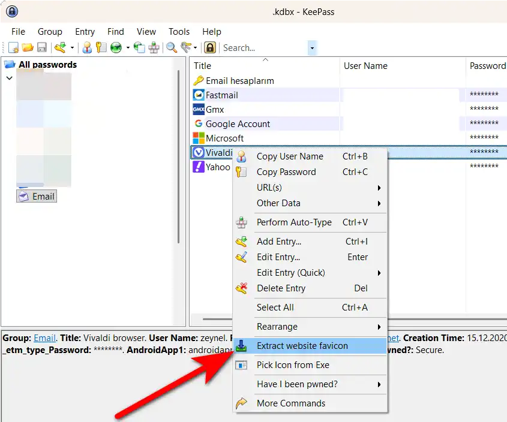
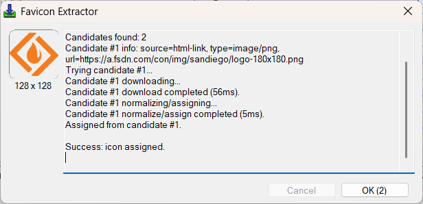

# KeePass Favicon Extractor

A KeePass 2 plugin that finds, downloads, and assigns website favicons using
multiple discovery sources. Extract automatically or optionally search for another icon.

## Highlights

- Entry right-click and main-menu integration in KeePass.
- Multi-source favicon discovery with ranked candidate selection: HTML parsing for fetching
  favicon (SVG, PNG, WEBP, ICO supported); fallback to multiple external services including
  Google, DuckDuckGo.
- Can download Android app icons from `androidapp://` URLs or the `AndroidApp1` / `AndroidApp` fields.
- Raster icons are stored on a square canvas up to 128 × 128 pixels. Smaller raster images
  are not upscaled; non-square images are padded. SVG icons are rendered to 128 × 128 pixels.
- Live extraction status and diagnostics windows.
- Multiple selection support for batch extraction.
- Optional icon chooser for a single website entry, with equal-size current/selected previews,
  image dimensions, and distinct prepared results as they become available.
- "Download missing icons" feature for eligible entries in a database.
- Reuses matching stored icons to avoid adding duplicate copies.
- Diagnostics window allows you to check if extension is working properly.

## Installation

- Download a package from [Releases](https://github.com/zeynelozturk/KeepassFaviconExtractor/releases).
- For the DLL package, extract its ZIP into your KeePass `Plugins` directory. This creates a
  FaviconExtractor subdirectory containing the plugin and its dependencies.
- Alternatively, copy the PLGX package's `FaviconExtractor.plgx` file into `Plugins`.
  Install one format, rather than both copies of the plugin.
- Restart KeePass.

## Usage

### Automatic extraction

- Right click an entry in KeePass and select "Extract website favicon" from the context menu.
- The plugin will attempt to find and download a favicon for the entry's URL,
convert it to a suitable format. If a favicon is found, it will be assigned to the entry.

Automatic extraction changes the entry's assigned icon without an additional confirmation.
Multiple selected entries can be processed together. Progress is shown during extraction.

For Android app icons, use a URL such as `androidapp://com.example.app`. When the URL
is empty, the plugin checks `AndroidApp1`, then `AndroidApp`, for an `androidapp://` value.
A nonempty website URL takes precedence over these custom fields.

### Choosing another icon

To choose a different icon, select one entry and open **Tools → Favicon Extractor →
Choose another icon…**. This command is available without running automatic extraction first.
The result window's **Look for other icons…** button is also enabled after a successful
single-entry website extraction; clicking it stops the countdown and opens the same chooser
for the processed entry.

The chooser searches existing sources for alternatives and shows distinct normalized results
as they become available. Both large previews use the same display size; the dimension labels
describe the actual images. Decoded source dimensions, when available, are shown separately
from the normalized output dimensions.

Select a preview, then click **Use selected icon** to apply it. Selecting a candidate alone
does not assign it. Cancel or closing the chooser leaves the current icon unchanged.
Available candidates can be selected while the search continues, and remain usable if some
sources fail. Some websites have no distinct alternative; the chooser reports this when its search finishes.

The chooser supports HTTP/HTTPS website and direct-image URLs for one entry at a time.
Android-only entries continue to use automatic extraction.

### Stored icons and cleanup

Both automatic extraction and the chooser reuse an existing database icon when its PNG data
matches the normalized result. Otherwise, one new custom icon is added and assigned to the entry.
Previously stored icon images are not overwritten or deleted, so other entries using them are unaffected.

Replacing an entry's icon leaves the previous icon stored, even if it becomes unused.
Existing duplicate icons are not removed automatically. To remove unused icons, use KeePass's
**Tools → Database Tools → Delete Unused Custom Icons** command. KeePass preserves icons
referenced by entries, groups, or entry history.

## Network and privacy behavior

- The plugin makes outbound HTTP/HTTPS requests to the target site's URL to discover icons.
- Automatic extraction may query external providers when website icons are missing, small,
  or cannot be used (for example Google, DuckDuckGo, Favicone, Vemetric, Favicon.im, and Hunter logo endpoint).
- The optional chooser also checks these existing providers when website icons are found,
  to look for alternatives.
- External providers receive host/domain-based values (host and sometimes parent domain),
  not the full entry URL path/query.
- Android app lookup sends the package name to Google Play and downloads an app icon from
  an image URL returned by its listing.
- Redirects that end on private or loopback addresses can be blocked with
  `EnforcePrivateAddressBlocking` (default is compatibility-first).
- Native WEBP loading prefers plugin-local `native/x64` and `native/x86`; legacy broad path
  fallback is controlled by `AllowLegacyNativeLibrarySearchFallback`.
- Some response reads use explicit size caps (`MaxHtmlReadBytes`, `MaxPlaceholderHashReadBytes`)
  to reduce memory-risk from oversized responses.

## Licensing and Third-Party Notices

- This project is licensed under GPL-3.0. See [LICENSE](LICENSE).
- Third-party component notices and license texts are provided in [THIRD-PARTY-NOTICES.txt](THIRD-PARTY-NOTICES.txt).
- Release ZIP artifacts include both files.

## Contact

For questions, bug reports, or feature requests, please open an issue on GitHub,
or contact the author at `zeynel@defkey.com`.

If extension fails to download a favicon for a specific URL, please include the
text you see in the icon download window.

For build and development notes, see [DEVELOPMENT.md](DEVELOPMENT.md).
